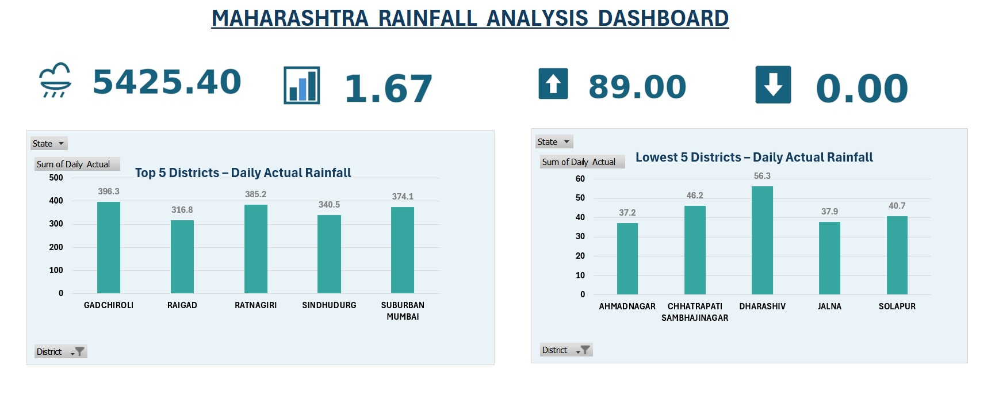

# Maharashtra Rainfall Analysis 🌧️

## 📌 Project Overview
This project focuses on analyzing rainfall data across Maharashtra using Microsoft Excel. It includes data analysis, district-wise rainfall insights, rainfall category analysis, data quality checks, and an interactive dashboard.

## 🎯 Project Objectives
- Analyze rainfall data for Maharashtra.
- Understand district-wise rainfall patterns.
- Categorize rainfall observations.
- Perform data quality checks.
- Present key insights through an Excel dashboard.

## 📊 Workbook Sheets
The Excel workbook contains the following sheets:

1. **Rainfall_Dashboard** – Visual representation of rainfall insights.
2. **Duplicate_Check** – Duplicate data checking.
3. **Lowest_5_Districts** – Analysis of the five lowest rainfall districts.
4. **District_Rainfall_Analysis** – District-wise rainfall analysis.
5. **Rainfall_Data_Analysis** – Main rainfall data analysis.
6. **Data_Quality_Check** – Data quality metrics and rainfall category counts.

## 🛠️ Tools & Technologies
- Microsoft Excel
- Excel Formulas
- COUNTIF and SUM Functions
- Data Analysis
- Data Visualization
- Excel Dashboard

## 📈 Key Features
- District-wise rainfall analysis.
- Rainfall category distribution (D, E, LD, LE, N, NR).
- Duplicate checking.
- Data quality validation.
- Interactive rainfall dashboard.

## 📁 Project File
`Maharashtra_Rainfall_Analysis.xlsx`

## 👨‍💻 Author
**Gaurav Mahajan**

---
## 📊 Project Dashboard

⭐ If you find this project useful, feel free to explore the repository!# Maharashtra-Rainfall-Analysis
Maharashtra Rainfall Analysis using Excel – Data Cleaning, District-wise Rainfall Analysis, Rainfall Categories, Data Quality Checks, and Interactive Dashboard.
